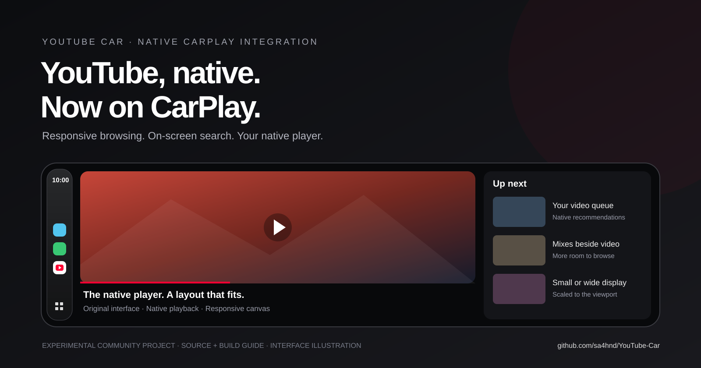

<p align="center"></p>

# YouTube Car · Native YouTube for Apple CarPlay

**The native YouTube app, adapted for the CarPlay screen.** Browse a responsive video grid, search with an on-screen keyboard, and watch with the video on the left and your queue on the right.

[](LICENSE)
[](docs/BUILD.md)
[](docs/ARCHITECTURE.md)
[](docs/COMPATIBILITY.md)

[Get started](docs/BUILD.md) · [How it works](docs/ARCHITECTURE.md) · [Compatibility](docs/COMPATIBILITY.md) · [Releases](https://github.com/sa4hnd/YouTube-Car/releases) · [Credits](NOTICE.md)

## What makes it different

This project hosts YouTube's **existing native interface and player** in a CarPlay scene. Its integration layer is Objective-C and Swift. Browsing does not use a website, screen mirroring, or a separate video extractor.

- **A responsive feed:** multiple video columns that fit the available display area.
- **A wide watch page:** video and details on the left; mixes or recommendations on the right on landscape displays.
- **Smaller screens handled:** a scaled logical canvas keeps controls and thumbnails proportionate.
- **Search on the car screen:** a dedicated touch keyboard with English, Arabic, symbols, and a query preview.
- **Native navigation:** the initialized controller tree, account state, and player are reused.
- **Phone ↔ car handoff:** a phone placeholder while connected; the original interface returns on disconnect.
- **Focused compatibility hooks:** Home grids, search, watch metadata, header scrolling, and the mini-player use separate rules.

The hero above is an original interface illustration, not evidence of head-unit certification. See [compatibility](docs/COMPATIBILITY.md) for the demonstrated baseline and limits.

## Start here

You need macOS, Xcode with an iPhoneOS SDK, Python 3.9+, and a compatible decrypted YouTube + YouMod IPA that you are authorized to use. Signing and CarPlay capabilities are your own; this project does not grant entitlements or bypass platform/vehicle restrictions.

```sh
git clone https://github.com/sa4hnd/YouTube-Car.git
cd YouTube-Car
python3 -m venv .venv
source .venv/bin/activate
python3 -m pip install -r requirements-build.txt

# Compile only: no IPA, certificate, profile, or device required.
python3 scripts/build_carplay.py --compile-only

# Produce an unsigned IPA from your own compatible input.
python3 scripts/build_carplay.py --ipa /path/to/YouMod.ipa --unsigned
```

For device signing, your own app ID, and installation, follow the [complete build guide](docs/BUILD.md). The [release](https://github.com/sa4hnd/YouTube-Car/releases) includes a compiled module and hashes; any IPA marked **unsigned** must be signed before installation.

## The working baseline

| Component | Baseline |
| --- | --- |
| Actual YouTube executable | 21.42.4 |
| YouMod | 2.0.0 |
| Reported bundle version | 21.45.4 |
| Integration | Native UIKit controller hosting + SwiftUI keyboard |
| Deployment target | iOS 17.0 |
| Source license | GPL-3.0; third-party notices apply |

The reported-version override resolved repeated playback error 14 on the development device according to the user's observation. **That is a compatibility workaround, not a universal playback fix or an upgrade to the underlying executable.** Keep the actual and reported versions distinct when reporting issues.

## Explore the source

| Path | Purpose |
| --- | --- |
| [`CarPlay/`](CarPlay) | Native scene lifecycle, surface ownership, responsive layout, input, and UI hooks |
| [`scripts/`](scripts) | Module compilation, IPA packaging/signing, device updates, and release auditing |
| [`tests/`](tests) | Packaging checks and native simulator harnesses for maintainers |
| [`vendor/YouMod/`](vendor/YouMod) | Attributed upstream YouMod source snapshot; not Google's application source |
| [`docs/`](docs) | Build steps, architecture, compatibility, and privacy/release instructions |

## FAQ

**Is this the source code of YouTube?** No. This repository contains the CarPlay integration and the credited YouMod source. Google's native application is an external binary input; its proprietary code and trademarks are not relicensed by this project.

**Does it work in every car?** That has not been established. The OS must provide an authorized drawable CarPlay window. Display geometry, app version, entitlement availability, and head-unit behavior matter.

**Can I install the release IPA immediately?** An unsigned IPA contains no signing profile and cannot launch until signed with an appropriate certificate/profile and your own authorized capabilities. A sideloader cannot grant missing CarPlay entitlements.

**Does it replace YouTube's player with AVPlayer?** No. The working baseline preserves YouTube's existing player. The proposed AVPlayer-backend fallback was not integrated.

**Why is playback sometimes account- or version-dependent?** Playback is also controlled by YouTube's service. Error 14 is generic. See [known issues](docs/COMPATIBILITY.md); endless automatic retries only mask failures.

**Why private?** This repository is currently private for preparation. GitHub topics, readable documentation, a clear description, and social artwork are ready for a future public release. Private repositories are not indexed for public search.

## Contributing

Report the actual YouTube version, reported version, iOS version, display size, and reproduction steps. Redact diagnostics before sharing. See [CONTRIBUTING.md](CONTRIBUTING.md) and [SECURITY.md](SECURITY.md).

## Credits and independence

Built on [YouMod](https://github.com/Tonwalter888/YouMod), with references to [YouTubeHeader](https://github.com/PoomSmart/YouTubeHeader) and packaging by [cyan](https://github.com/asdfzxcvbn/pyzule-rw). Full attribution is in [NOTICE.md](NOTICE.md).

An independent community project. Not affiliated with or endorsed by Google, YouTube, or Apple. YouTube and CarPlay are trademarks of their respective owners.
