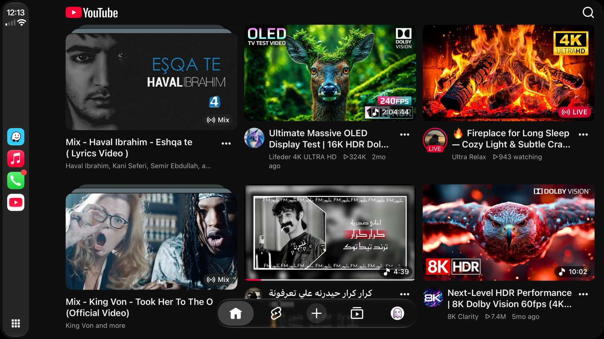
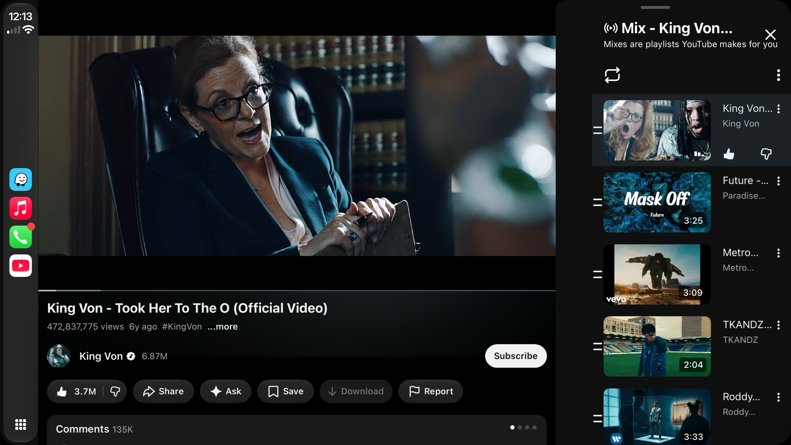

<div align="center">

# YouTube Car · Native YouTube for Apple CarPlay

**Your familiar YouTube app. A layout built for the car display.**

Native playback · Responsive video grids · Video + queue split view · On-screen keyboard

[](#how-it-works)
[](docs/COMPATIBILITY.md)
[](docs/BUILD.md)

[Watch the demo](https://github.com/sa4hnd/YouTube-Car/releases/download/v0.1.0/youtube-carplay-demo.mp4) · [Get started](#get-started) · [Build guide](docs/BUILD.md) · [Architecture](docs/ARCHITECTURE.md)

</div>



> Experimental native YouTube CarPlay integration for iPhone, based on YouTube + YouMod. This repository contains the CarPlay integration source, build tools, and an attributed YouMod source snapshot. It does not contain Google's YouTube application source or a ready-to-install signed YouTube IPA.
>
> Video viewing and touch interaction are intended for use while parked. Follow local laws and your vehicle's restrictions.

## See it in action

https://github.com/user-attachments/assets/4c30c2ad-0ecf-4bc1-9ca1-70908ee1c19f



**[▶ Watch / download the demo video](https://github.com/sa4hnd/YouTube-Car/releases/download/v0.1.0/youtube-carplay-demo.mp4)** — recorded app footage, exported without audio or recording metadata.

## What makes YouTube Car different?

This integration brings the **native YouTube iPhone app to Apple CarPlay**, retaining YouTube's own interface and playback engine while adapting its layout to the available display.

| Experience | What the integration adds |
| --- | --- |
| Home feed | Responsive thumbnail grids instead of oversized phone cards |
| Watch page | Video and details on the left; Mix, playlist, or recommendations on the right on landscape displays |
| Smaller screens | A scaled logical canvas keeps the interface from becoming excessively zoomed in |
| CarPlay sidebar | Controls respect the display's safe area while the app background fills its surface |
| Search | An on-screen keyboard with English, Arabic, shift, symbols, text preview, and submit |
| Navigation | Compact header behavior and scroll-aware hiding / revealing |
| Mini-player | Geometry adapted for YouTube's floating player inside the app |
| Seeking | Thicker progress tracks and larger touch targets on the car display |
| Phone use | The original phone scene is preserved; its app surface returns when CarPlay disconnects |

The screenshots show the development build. Layout and feature behavior can change with the underlying YouTube version and head unit.

## How it works

**We reuse the real native YouTube interface and player, then adapt the app's window, scene, and layout behavior for CarPlay.** There is no browser page, screen-mirroring stream, or replacement AVPlayer backend in this integration.

1. **Build a native integration module.** Objective-C runtime hooks and a Swift keyboard compile into `YouTubeCarPlay.dylib`.
2. **Preserve YouTube's initialization.** The initialized `YTAppViewControllerImpl` surface moves between the phone window and the authorized CarPlay host. We retain the original phone scene delegate instead of constructing an unrelated app root.
3. **Register the CarPlay scene routes.** The packager adds CarPlay scene configuration while retaining the phone configuration. The host needs a drawable CarPlay window supplied by the OS and permitted by its provisioning profile.
4. **Adapt to the actual viewport.** A logical canvas, uniform scaling, safe-area handling, and targeted native layout hooks produce the feed grid and split watch page. This is custom responsive behavior; simply reporting “iPad” is not the whole implementation.
5. **Keep the native playback stack.** YouMod and YouTube continue providing their existing functionality. A reported-version compatibility override is separate from the actual executable version.
6. **Package and sign locally.** The builder injects the module into your compatible decrypted input IPA and either exports an unsigned package or signs and installs with your own authorized profile.

Read the [architecture notes](docs/ARCHITECTURE.md) for the scene handoff, layout scope, keyboard, and runtime boundaries.

## Compatibility

| Requirement | Current project baseline |
| --- | --- |
| Intended / reported OS range | **iOS 26.4–27.2**, experimental; not every version in this range has been verified |
| Demonstrated OS | **iOS 27.0.1**, reported working during development |
| Actual input app | **YouTube 21.42.4 + YouMod 2.0.0** |
| Reported compatibility version | **21.45.4**; this does not upgrade the underlying YouTube executable |
| Module deployment target | **iOS 17.0**; a build floor, not a claim of CarPlay video support on iOS 17 |
| Build environment | macOS, Xcode with an iPhoneOS SDK, Python 3.9+ |
| Car display | Compatible CarPlay connection, OS scene support, and appropriate signing capabilities |

Versions below 26.4 or above 27.2 are outside the stated intended range. Even within that range, entitlement availability, OS behavior, YouTube internals, and vehicle support determine whether it works. See [compatibility and known limits](docs/COMPATIBILITY.md).

## CarPlay video entitlement and signing

The device-installation path requires a provisioning profile authorizing:

```xml
<key>com.apple.developer.carplay-video</key>
<true/>
```

Your **App ID, signing certificate, provisioning profile, and registered device must match**. Other entitlements must also be allowed by that profile; the builder retains permitted capabilities rather than inventing authorization.

Adding this key to an entitlements file does **not** grant the capability. A normal sideloading workflow cannot grant a restricted entitlement missing from the provisioning profile. Obtain the required capability through an authorized Apple developer provisioning setup. This repository supplies no certificates, private keys, device registrations, or entitlement-granting workaround.

Scene declarations and the entitlement serve different purposes: scene configuration describes the app's CarPlay routes; provisioning determines which capabilities the signed app is allowed to use.

## Get started

### If you are not a developer

1. Read the [compatibility table](#compatibility) and [signing requirements](#carplay-video-entitlement-and-signing) first.
2. Open [Releases](https://github.com/sa4hnd/YouTube-Car/releases) for the build kit and compiled integration module. **These are not a standalone installable YouTube app.**
3. You will need a compatible decrypted YouTube + YouMod IPA that you are authorized to modify, plus your own suitable signing setup.
4. Follow the [illustrated-by-command build and installation guide](docs/BUILD.md), or have a developer perform those steps with your own authorized assets.
5. Connect the installed iPhone to a compatible CarPlay display while parked. If the icon or window is missing, check capabilities and OS support before reinstalling repeatedly.

There is no one-tap IPA download in this repository. The included source builds the integration; it cannot rebuild Google's proprietary YouTube app from source.

### If you are a developer

Clone this repository, select Xcode, and build the integration:

```sh
git clone https://github.com/sa4hnd/YouTube-Car.git
cd YouTube-Car
python3 -m venv .venv
source .venv/bin/activate
python3 -m pip install -r requirements-build.txt
python3 scripts/build_carplay.py --compile-only
```

This produces `build/YouTubeCarPlay.dylib`.

**Export an unsigned IPA from your own input:**

```sh
python3 scripts/build_carplay.py \
  --ipa /path/to/YouMod.ipa \
  --unsigned \
  --bundle-id com.example.youtubecar \
  --reported-version 21.45.4
```

**Or sign and install using your own authorized profile:**

```sh
python3 scripts/build_carplay.py \
  --ipa /path/to/YouMod.ipa \
  --profile /path/to/your.mobileprovision \
  --bundle-id com.example.youtubecar \
  --device YOUR_DEVICE_UDID
```

Replace all placeholders with your own local values. Keep signing files outside the repository. The script checks the input and profile, compiles, injects, packages, and—on the signed path—installs and launches. See [BUILD.md](docs/BUILD.md) for prerequisites, output files, module-only updates, and rollback.

<details>
<summary><strong>What is included in the repository?</strong></summary>

| Path | Purpose |
| --- | --- |
| `CarPlay/` | Native CarPlay host, runtime hooks, responsive layouts, and keyboard |
| `scripts/` | Compilation, IPA packaging, installation, release packaging, and privacy audit |
| `vendor/YouMod/` | Attributed upstream source snapshot; the supplied input IPA's compiled YouMod is reused by default |
| `docs/` | Build, architecture, compatibility, and release documentation |
| `assets/` | Project artwork and app screenshots |

No separate CarTV application, signing credentials, account data, or proprietary input IPA is included.

</details>

## Frequently asked questions

**Is this the official YouTube app for CarPlay?**  
No. This is an independent experimental integration, unaffiliated with Google or Apple. It modifies a compatible native YouTube + YouMod installation.

**Is this just an iPad layout?**  
The interface uses native YouTube views with custom CarPlay hosting, viewport scaling, safe-area handling, and scoped layout hooks. Landscape displays use the requested video-left / queue-right arrangement; it is not a universal tablet-mode toggle.

**Why not provide a signed IPA?**  
Signing is specific to the owner's authorized identity and profile. The base YouTube binaries also have separate distribution rights. We provide integration source and build tools; you provide the authorized input and signing assets.

**Does version spoofing fix all playback errors?**  
No. Reporting 21.45.4 resolved the observed failure on the development device. YouTube service changes, accounts, and input versions can produce different results. See the [playback notes and upstream discussions](docs/COMPATIBILITY.md#playback-error-14).

**Will every YouTube update or CarPlay screen work?**  
No guarantee. Native private classes and layouts can change. Include actual app version, reported version, OS version, viewport size, and reproduction steps when reporting a problem; remove personal information from attachments.

## Documentation and contributions

[Build & install](docs/BUILD.md) · [Architecture](docs/ARCHITECTURE.md) · [Compatibility](docs/COMPATIBILITY.md) · [Contributing](CONTRIBUTING.md) · [Security](SECURITY.md) · [Release process](docs/RELEASING.md) · [Changelog](CHANGELOG.md)

## Credits and licensing

Built on the work of the [YouMod project](https://github.com/Tonwalter888/YouMod) and its contributors, with upstream components credited in [NOTICE.md](NOTICE.md). Preserve all upstream notices and applicable source-license obligations when redistributing.

The integration's source licensing is described in [LICENSE](LICENSE). Google's YouTube application and other third-party binaries are not relicensed by this repository. YouTube and Apple CarPlay are trademarks of their respective owners.
